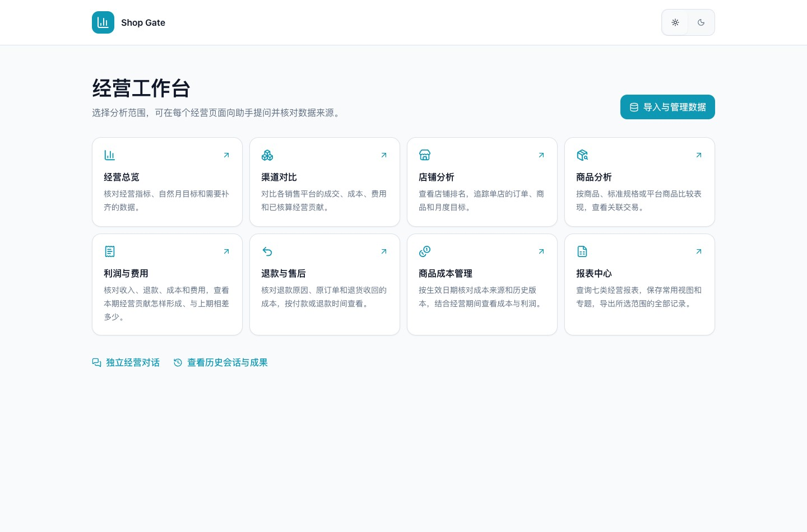
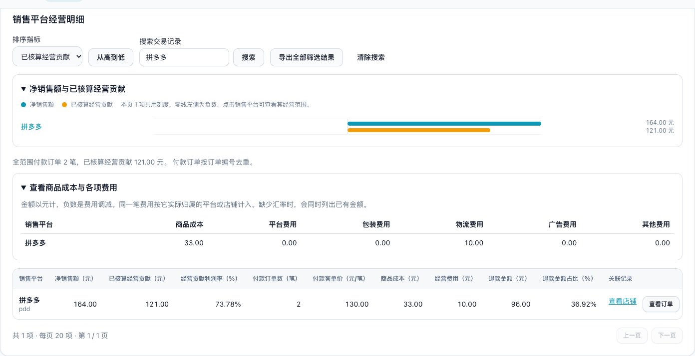
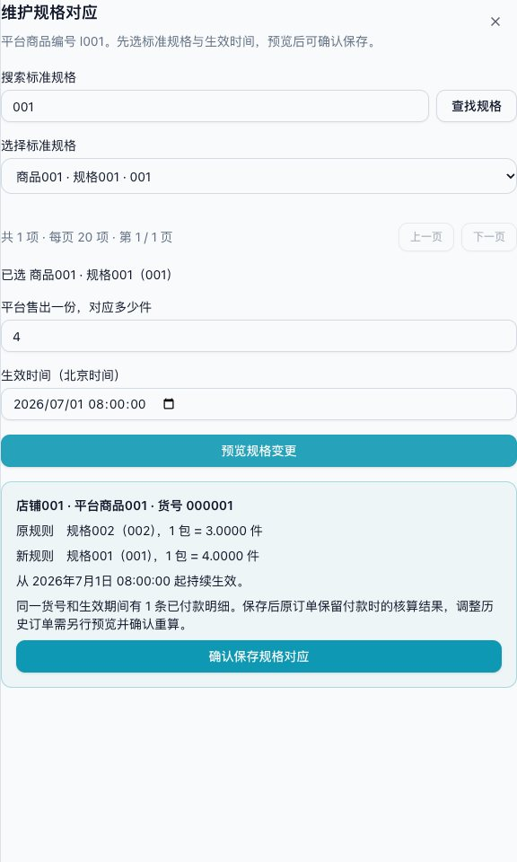
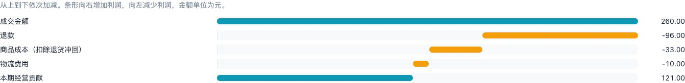
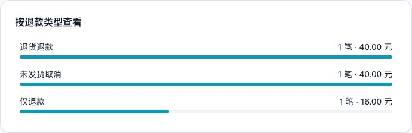
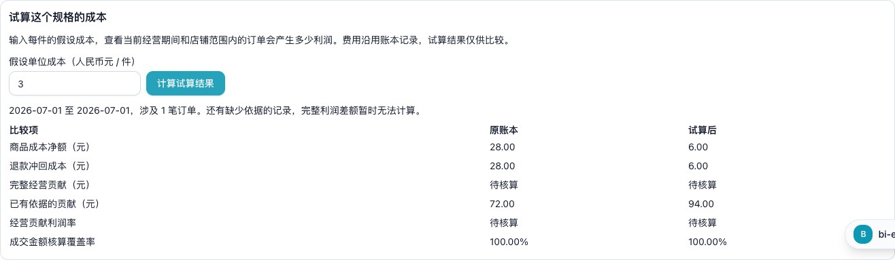
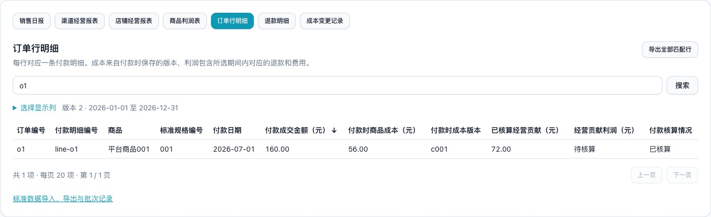
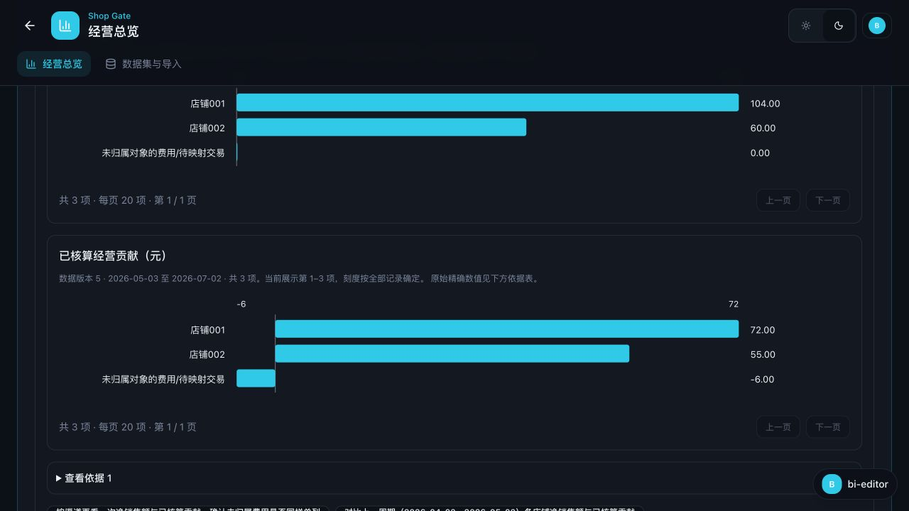
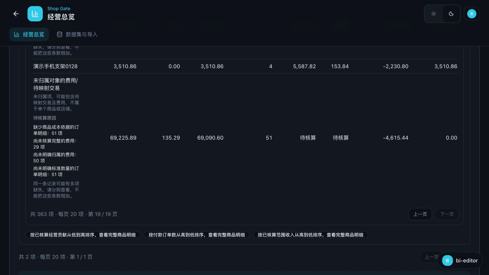

# Shop Gate · 电商经营分析工作台

从一笔成交出发，Shop Gate 可以帮你查清收到多少钱、退了多少钱、哪些商品有贡献，以及哪些成本还缺依据。经营总览和助手共用同一份订单、退款、商品成本和费用账本。你可以直接查看数字，也可以用中文提问，打开回答里的明细复核。

本指南适用于 v0.1，覆盖八个经营模块、标准数据导入和经营助手。[功能对照表](docs/review/v01/feature-matrix.md)

## 第一次使用：从导入到复核一笔利润

从首页选择经营模块，也可以点 **独立经营对话**，选择数据后直接向助手提问。要找改版前保存的对话或下载旧文件，点 **查看历史会话与成果**，选择有权访问的会话，再打开 **成果文件**。



### 1. 创建数据集，选择数据来源

登录后打开 **数据集与导入**（`/bi/data`），选择工作空间，在 **创建数据集** 填写名称。选择数据来源后，点击 **创建并选择数据集**。

| 你手上的数据 | 接下来怎么做 |
| --- | --- |
| 想先熟悉操作 | 选 **演示：独立模拟数据**。在新建的空演示集选择业务开始日期，点击 **准备演示预览**。默认生成 3 个平台、9 家店铺、1,000 个商品规格、12,000 笔订单和 180 天的记录。随机种子控制抽样，日期控制经营期间。 |
| 有自己的订单和费用 | 选 **正式导入**。从 **模板与字段说明** 下载所需的空白 CSV 模板，按原样保留编号中的前导零。商品、规格、订单和订单明细分别填表。上传文件后先检查预览。 |


**跟着图做一遍：** [下载手算样例（12 个 CSV，ZIP）](docs/examples/manual-ledger.zip)，解压到一个文件夹。新建来源为“正式导入”的空数据集，一次选中这 12 个 CSV，点击 **检查并生成导入预览**。这些是练习记录，建议将数据集命名为“手算练习”。

图中是一份方便手算的小样本。付款成交 **260 元**，退款 **96 元**，净销售额应为 **164 元**。核对文件、行数和试算金额后点击 **检查完成，确认导入**，按页面提示确认。若发现错误，点击 **下载全部校验结果**，按文件、行号和字段修正后重新预览。在批次记录中查看写入结果和新版本。

想重新练习时，在已有演示集的 **准备独立演示数据** 中选择 **从头开始一份演示**，核对名称并确认。切换到新演示后选日期和随机种子，再预览、确认。原演示和分析记录仍可在列表中打开。

### 2. 在经营总览确定范围

从工作台首页打开 **经营总览**（`/bi/overview`），先看顶部的工作空间、数据集和版本，再选日期、平台、店铺或商品。默认最近 30 天以这份数据的最新业务日期为准。


用上一步的小样本复核：净销售额 **164 元**，减商品成本净额 **33 元**，再减经营费用 **10 元**，得到经营贡献 **121 元**。经营贡献用于比较这批交易覆盖的收入和支出。看到 **待核算** 时，打开对应明细查看缺少的是成本、汇率还是其他依据。

#### 在渠道或店铺里核对一笔费用

打开 **渠道对比** 或 **店铺分析**，选择与经营总览相同的数据集和日期。在 **搜索交易记录** 输入平台名、店铺名或平台原始订单号，然后点击 **搜索**。例如导入手算样例后，选择 2026 年 7 月 1 日至 2 日和付款日期口径，搜索“拼多多”，净销售额应为 **164 元**。

展开 **查看商品成本与各项费用**。样例中拼多多共有 **10 元物流费用**，其中 **4 元**直接归属店铺 001，另有 **6 元**只归属平台。负数表示费用调减。某笔外币费用缺少汇率时，对应类别显示“待核算”，旁边列出已有金额。点击 **导出全部筛选结果** 可下载所有页，CSV 中分别列出各类费用及已核算部分。



需要核对来源时，点击 **查看付款、退款和费用**。选择记录类型，再输入来源编号。例如在上述样例中查找退款 `r1`，展开可看到平台原始订单号、人民币退款额、原币付款与退款时间。点击某家店铺行内的 **查看费用和退款**，明细会沿用这家店铺的范围。

#### 从商品表现追到订单

打开 **商品分析**，按商品、标准规格或平台商品查看。**按畅销程度排名** 会将净销售额最高的分组排在前面。销售与利润率分布图显示收入排名靠前的分组，展开图下的明细可以读取准确数值。

用 **筛选商品表现** 找到贡献为负、利润率低于 10%、付款金额中退款超过 10% 或还有待核算记录的商品。页面写明用哪个期间和哪种商品分组进行判断。查看关联店铺、导出或向助手提问时，仍可核对同一组商品。商品排名里的平均单位售价和历史加权单位成本均以付款时的标准销量计算。查看“有成本依据的标准销量”即可判断有多少销量参与了单位成本计算。

要找出哪些商品需要补资料，打开 **筛选商品表现**。选择 **付款时缺少规格成本**，可查看已有标准规格、但原订单找不到有效成本记录的商品。选择 **付款时没有对应标准规格**，列表会切换到平台商品，显示受影响的货号。两项都按订单付款时的核算记录判断。打开 **查看付款、退款和费用** 可逐笔核对；同一货号在其他订单上可能已有完整资料。

要比较同一规格在不同店铺的销量，把 **查看方式** 切到 **标准规格**，在该行点击 **查看店铺** 或 **查看同款的平台表现**。在新页面可按标准销量排序，同时核对标准单位、平均单位售价、付款时的加权单位成本和有成本依据的销量。导出沿用当前对象和日期。

在 **平台商品与标准规格** 中输入平台货号，例如固定核算样例的 `000001`。选择 2026 年 7 月 2 日可查看该店铺 1 包对应多少件、规则从何时生效。选择 **尚未对应** 可以找出该日期缺少换算规则的货号。目录也包含没有成交的商品，支持按编码或名称排序、每页 20 条翻页。点击行内 **查看所选期间付款明细** 可核对该货号的交易。


需要修改时，在相应货号行点击 **维护规格对应**，搜索并选择标准规格，填写一份平台商品折合的标准数量及生效时间。点击 **预览规格变更** 核对原规则、新规则、有效期间和涉及的已付款明细数，再点击 **确认保存规格对应**。原订单仍可按付款时的规则核对；历史调整要另行预览并确认重算。



要核对某个货号在店铺里用的是哪笔成本，点 **查看店铺成本依据**。选好日期后，先看每件的金额、原币和来源，再查看下方列出的基础、平台和店铺成本版本。点 **查看所选期间付款明细** 可以核对订单付款时留存的成本。

使用经营助手准备换算草案时，可以在目录点击 **选择此货号继续分析**，再提问“请把这个货号改为每包 4 件，标准规格是 001，从 2026 年 7 月 1 日上午 8 点开始，先给我草案”。点击答案中的 **核对商品规格换算草案**，从目录选中实际规格并核对生效时间。预览会列出原规则、新规则和受影响的已付款明细。如要生效，再点击 **确认保存规格对应**。

#### 核对利润和费用

打开 **利润与费用**，选择数据集和日期。每行表示该项目增加或减少了多少经营利润。以手算样例的 7 月 1 日、原订单付款日期为例，成交 260 元，退款 96 元，退货冲回后的成本为 33 元，物流费用为 10 元，经营贡献利润为 **121 元**。其中 6 元物流费用尚未分摊，在平台范围已计入总额。



选择 **与上期相比**，可查看相同天数内每个项目带来的金额变化。上期日期覆盖不足时，只展示本期。使用 **利润分组** 比较店铺、平台或商品，点击 **导出全部筛选结果** 下载整份表。要核对来源，点击 **查看费用归属**，展开具体记录，查看来源金额和当前范围承担的金额。

#### 追溯一笔退款

打开 **退款与售后**。选择 **按原付款日期** 可以回答“这批订单退了多少钱”。选择 **按退款完成日期** 可以回答“今天处理了多少退款”。在手算样例中，7 月 1 日付款的两笔订单在 7 月 2 日发生三笔退款，共 96 元。退款笔数与订单数在这里有意分开。



点击某个退款原因或类型，再展开一笔退款，可以看到原币金额、退回数量、可回收数量和冲回的商品成本。使用 **查看原单付款明细** 核对原始订单，浏览器返回即可回到先前的退款筛选。**导出全部退款** 会下载当前筛选范围内的每一笔退款。

#### 查某天生效的商品成本

打开 **商品成本管理**。上方经营期间决定页面汇总哪些付款、退款和费用，**成本查看日期** 决定采用哪个版本的单位成本。先选择店铺，再搜索标准规格。表格并列展示当前适用成本和基础成本，单位包含币种和标准单位。点击 **查看该规格的版本** 可按生效时间追溯来源；**导出全部当前成本** 会导出当前筛选的全部规格。


图中的规格 001 在 7 月 2 日有三层成本。选中这家店铺时，每件采用店铺成本 3 元。切回 7 月 1 日查看，当时生效的是每件 2 美元的基础成本。历史订单使用付款时已经记录的成本。

要比较一种新报价，展开规格版本，在 **试算这个规格的成本** 输入每标准单位的人民币金额，然后点击 **计算试算结果**。原账本和试算后的利润、退款冲回成本并排显示。缺少费用或汇率时，完整经营贡献会显示为「待核算」。



有编辑权限时，勾选一个或多个规格，选择固定金额、金额增减或百分比增减，填写生效时间、币种和原因，再点击 **预览成本调整**。核对每个规格和涉及的历史明细后，点击 **确认保存成本版本**。已有订单仍使用原核算结果。需要重新计算历史订单时，展开 **重新核算历史付款**，选择付款期间与规格，核对预览后确认。已保存的改价和重算可在 **成本维护记录** 查看。

#### 将常用查询保存为报表

打开 **报表中心**，选择日期、店铺和报表类型。在 **订单行明细** 输入订单编号（例如手算集的 `o1`）并点击 **搜索**。打开 **选择显示列** 勾选需要的项目，点击列名可以排序。



点击 **导出全部匹配行** 下载当前筛选和列对应的 CSV。翻页只改变屏幕上看到的行。在 **我的报表视图与专题** 输入名称并点击 **保存当前视图**；下次登录后，点 **打开** 即可在当前数据版本重用日期、筛选、列和排序。标准模板、数据导入和批次记录可从表格下方的链接进入。

要保留某次分析，在报表页向助手提问，展开回答里的依据核对数据，再点 **将这次回答保存为专题**，填写名称并确认。数据更新后，专题仍显示原回答及它使用的版本。

### 3. 向助手提问并检查答案

在总览下方的 **经营助手** 输入：“按当前日期范围，对比各店铺的净销售额和已核算经营贡献，列出明细并画柱状图。”选择已配置的模型，点击 **发送问题**。回答、图表和明细关联到提问时的数据版本。



在手算样例中，两家店铺分别贡献 **72 元**和 **55 元**，另有 **−6 元**未归属费用，三项合计 **121 元**。点击 **查看依据** 可复核每一项。导入、翻页和刷新都无需再次调用模型。



上图换用 180 天演示集。该次查询有 363 项结果，每页 20 项，最后一页仍可访问。未归属项表示部分交易或费用还无法对应到具体商品。若同一笔记录同时缺少成本与规格映射，两条原因都会显示，不能把条数相加当作订单数。

#### 在本地 MCP 客户端查经营口径

在网页的「经营业务知识中心 → 业务知识」也可以搜索这些说明、展开条目并查看版本。

安装开发依赖（`npm ci`）后，可在支持标准输入输出的 MCP 客户端中添加一个本地服务，工作目录设为本项目根目录，命令填 `node`，参数依次填 `--import`、`tsx`、`scripts/mcp/operating-methods.ts`。支持直接填写整条启动命令的客户端也可用 `npm run --silent mcp:methods`。

例如提问“仅退款时还扣商品成本吗？”。客户端用 `search_operating_methods` 找到“退款日期、仅退款和退货成本”，再读取返回的资源地址。说明包含适用模块、Skill 版本和来源摘要。这里可以查八个模块的公开方法；要核对某笔退款的实际金额，请在经营页面选择数据集和订单，向页内助手提问。

### 4. 修改月度目标

有维护权限的成员可以在总览的月度目标中选择店铺和月份，点击 **修改目标**。填写目标后点击 **预览目标变更**，核对原值、新值和店铺，再确认保存。


图中店铺当月净销售额是 **60 元**。将该月净销售额目标设为 **600 元**后，对应完成率为 **10%**。月份按店铺的完整自然月统计。也可以在选中店铺后告诉助手“把这家店 7 月的净销售额目标改为 1,200 元，经营贡献目标保持原值”。点击回答中的 **核对月度目标草案** 查看两项金额。若确实要取消原有的经营贡献目标，请在编辑器中清空该项，再预览和确认。

### 5. 找回以前的会话和成果

在首页点击 **查看历史会话与成果**，选择会话后打开 **会话内容** 或 **成果文件**。每页有 20 项，文件夹可以逐层打开。原会话书签仍可使用，会转到对应的只读记录。要复查原先按浏览、加购、购买估算的数值，请在历史页面选择 **历史行为分析**。按实付订单核对金额请打开 **经营总览**。

## 本地启动

准备 Node.js 22.19 或更高版本、npm、uv、Python 3.14 及 Docker。以下命令在产品仓库根目录执行。首次运行建议使用独立开发数据库。

```bash
npm ci
npm run ensure:env
uv sync --project services/commerce-data
npm run db:up
npm run db:init
```

1. 按[本地认证说明](docs/authentication.md)配置登录账号及工作空间权限。按[经营接口配置](docs/review/v01/bi-http.md)分别配置 Web、经营数据服务和服务间签名。所需变量见[经营运行配置样例](deploy/examples/bi-runtime.conf.example)，工作进程、迁移和维护账号各有独立样例。
2. 经营账本使用独立迁移入口。配置迁移连接后，执行下面的命令。已有经营数据的环境先按[备份恢复手册](docs/review/v01/backup-recovery.md)完成备份与恢复演练。
3. 启动 Web 和经营数据服务，在第二个终端按[数据任务配置](docs/review/v01/bi-jobs.md)启动导入导出进程。若要使用演示数据，在演示环境开启 `SHOPGATE_BI_DEMO_ENABLED=1`。

```bash
uv run --project services/commerce-data python -m shopgate_commerce_data.ledger.migrations
npm run dev
```

```bash
# 第二个终端，使用数据任务专用的运行配置
uv run --project services/commerce-data shopgate-bi-worker
```

在启动日志显示的地址登录，默认端口为 3000。使用经营助手时，为 Web 和助手进程配置授权模型。使用 DeepSeek 官方直连时，通过私有环境注入 `DEEPSEEK_API_KEY`，启用 Agent，在另一个终端运行 `npm run worker:bi`，然后在页面选中 DeepSeek。查看与导入账本可独立于模型运行。[模型与服务配置](docs/configuration.md) · [助手进程说明](docs/review/v01/agent-scopes.md)

## 遇到问题

| 页面提示或现象 | 可以怎样处理 |
| --- | --- |
| 已上传文件，经营金额还没变 | 打开处理任务详情查看状态。“预览已完成”后还要确认写入，再核对版本和批次。 |
| 预览过期，或版本已变化 | 以当前版本重新预览，再核对新试算值。 |
| 总览为空 | 检查数据集、业务日期及筛选，确认有已写入的订单。查看核算提醒可了解缺少哪些数据。 |
| 可以看总览，不能发起分析 | 查看助手显示的权限、模型和处理服务状态。管理员可检查助手 Worker、模型配置及配额。 |
| 要查看旧项目对话或维护运行环境 | 从原项目入口打开历史会话。运维命令和配置见[文档目录](docs/README.md)、[运行手册](docs/operations-runbook.md)和[发布手册](docs/release-runbook.md)。 |

授权条款见 [LICENSE](LICENSE)。
