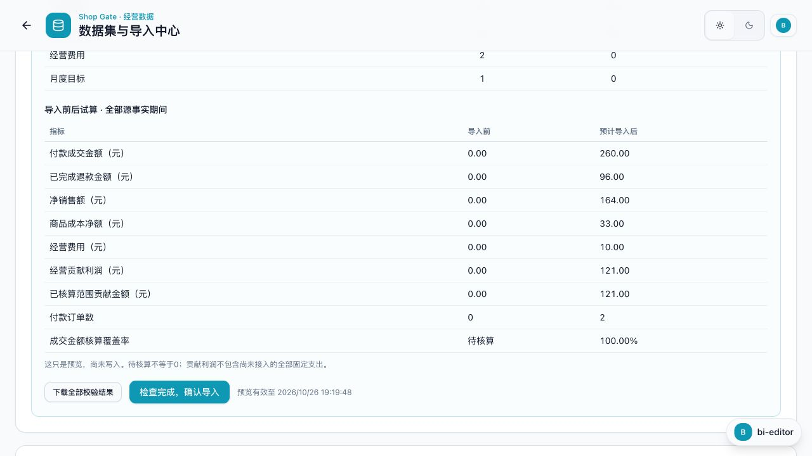
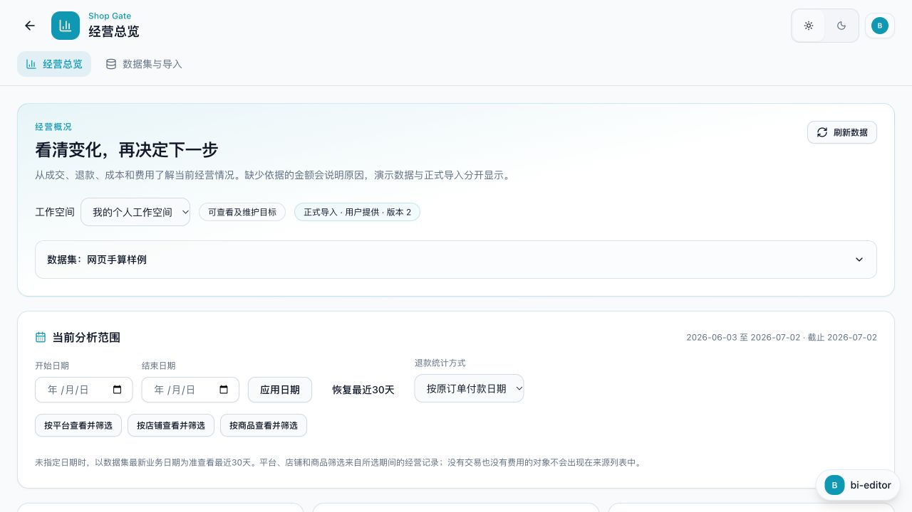
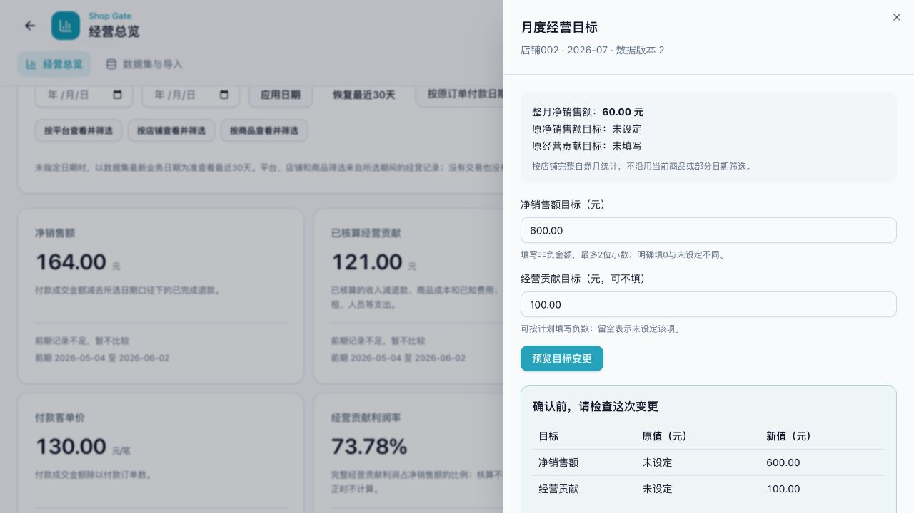

# Shop Gate · 电商经营分析工作台

从一笔成交出发，Shop Gate 可以帮你查清收到多少钱、退了多少钱、哪些商品有贡献，以及哪些成本还缺依据。经营总览和助手共用同一份订单、退款、商品成本和费用账本。你可以直接查看数字，也可以用中文提问，打开回答里的明细复核。

**v0.1 正在开发。** 这份指南覆盖已用浏览器核对的数据导入、经营总览、月度目标和助手问答。八个业务模块的完整发布范围见[功能对照表](docs/review/v01/feature-matrix.md)。

## 第一次使用：从导入到复核一笔利润

### 1. 创建数据集，选择数据来源

登录后打开 **数据集与导入**（`/bi/data`），选择工作空间，在 **创建数据集** 填写名称。选择数据来源后，点击 **创建并选择数据集**。

| 你手上的数据 | 接下来怎么做 |
| --- | --- |
| 想先熟悉操作 | 选 **演示：独立模拟数据**。在新建的空演示集选择业务开始日期，点击 **准备演示预览**。默认生成 3 个平台、9 家店铺、1,000 个商品规格、12,000 笔订单和 180 天的记录。随机种子控制抽样，日期控制经营期间。 |
| 有自己的订单和费用 | 选 **正式导入**。从 **模板与字段说明** 下载所需的空白 CSV 模板，按原样保留编号中的前导零。商品、规格、订单和订单明细分别填表。上传文件后先检查预览。 |



**跟着图做一遍：** [下载手算样例（12 个 CSV，ZIP）](docs/examples/manual-ledger.zip)，解压到一个文件夹。新建来源为“正式导入”的空数据集，一次选中这 12 个 CSV，点击 **检查并生成导入预览**。这些是练习记录，建议将数据集命名为“手算练习”。

图中是一份方便手算的小样本。付款成交 **260 元**，退款 **96 元**，净销售额应为 **164 元**。核对文件、行数和试算金额后点击 **检查完成，确认导入**，按页面提示确认。若发现错误，点击 **下载全部校验结果**，按文件、行号和字段修正后重新预览。在批次记录中查看写入结果和新版本。

### 2. 在经营总览确定范围

从工作台的页面切换菜单打开 **经营总览**（`/bi/overview`），先看顶部的工作空间、数据集和版本，再选日期、平台、店铺或商品。默认最近 30 天以这份数据的最新业务日期为准。



用上一步的小样本复核：净销售额 **164 元**，减商品成本净额 **33 元**，再减经营费用 **10 元**，得到经营贡献 **121 元**。经营贡献用于比较这批交易覆盖的收入和支出。看到 **待核算** 时，打开对应明细查看缺少的是成本、汇率还是其他依据。

### 3. 向助手提问并检查答案

在总览下方的 **经营助手** 输入：“按当前日期范围，对比各店铺的净销售额和已核算经营贡献，列出明细并画柱状图。”选择已配置的模型，点击 **发送问题**。回答、图表和明细关联到提问时的数据版本。


在手算样例中，两家店铺分别贡献 **72 元**和 **55 元**，另有 **−6 元**未归属费用，三项合计 **121 元**。点击 **查看依据** 可复核每一项。导入、翻页和刷新都无需再次调用模型。


上图换用 180 天演示集。该次查询有 363 项结果，每页 20 项，最后一页仍可访问。未归属项表示部分交易或费用还无法对应到具体商品。若同一笔记录同时缺少成本与规格映射，两条原因都会显示，不能把条数相加当作订单数。

### 4. 修改月度目标

有维护权限的成员可以在总览的月度目标中选择店铺和月份，点击 **修改目标**。填写目标后点击 **预览目标变更**，核对原值、新值和店铺，再确认保存。



图中店铺当月净销售额是 **60 元**。将该月净销售额目标设为 **600 元**后，对应完成率为 **10%**。月份按店铺的完整自然月统计。也可以在选中店铺后告诉助手“把这家店 7 月的净销售额目标改为 1,200 元，经营贡献目标保持原值”。点击回答中的 **核对月度目标草案** 查看两项金额。若确实要取消原有的经营贡献目标，请在编辑器中清空该项，再预览和确认。

## 本地启动

准备 Node.js 22.19 或更高版本、npm、uv、Python 3.14 及 Docker。以下命令在产品仓库根目录执行。首次运行建议使用独立开发数据库。

```bash
npm ci
npm run ensure:env
uv sync --project services/commerce-data
npm run db:up
npm run db:init
```

1. 按[本地认证说明](docs/authentication.md)配置登录账号及工作空间权限。按[经营接口配置](docs/review/v01/bi-http.md)分别配置 Web、经营数据服务和服务间签名。
2. 经营账本使用独立迁移入口。配置迁移连接后，执行下面的命令。已有经营数据的环境先按[备份恢复手册](docs/review/v01/backup-recovery.md)完成备份与恢复演练。
3. 启动 Web 和经营数据服务，在第二个终端按[数据任务配置](docs/review/v01/bi-jobs.md)启动导入导出进程。若要使用演示数据，在演示环境开启 `SHOPGATE_BI_DEMO_ENABLED=1`。

```bash
uv run --project services/commerce-data python -m shopgate_commerce_data.ledger.migrations
npm run dev
```

```bash
# 第二个终端，使用数据任务专用的运行配置
uv run --project services/commerce-data shopgate-bi-worker
```

在启动日志显示的地址登录，默认端口为 3000。使用经营助手时，为 Web 和助手进程配置授权模型。使用 DeepSeek 官方直连时，通过私有环境注入 `DEEPSEEK_API_KEY`，启用 Agent，在另一个终端运行 `npm run worker:bi`，然后在页面选中 DeepSeek。查看与导入账本可独立于模型运行。[模型与服务配置](docs/configuration.md) · [助手进程说明](docs/review/v01/agent-scopes.md)

## 遇到问题

| 页面提示或现象 | 可以怎样处理 |
| --- | --- |
| 已上传文件，经营金额还没变 | 打开处理任务详情查看状态。“预览已完成”后还要确认写入，再核对版本和批次。 |
| 预览过期，或版本已变化 | 以当前版本重新预览，再核对新试算值。 |
| 总览为空 | 检查数据集、业务日期及筛选，确认有已写入的订单。查看核算提醒可了解缺少哪些数据。 |
| 可以看总览，不能发起分析 | 查看助手显示的权限、模型和处理服务状态。管理员可检查助手 Worker、模型配置及配额。 |
| 要查看旧项目对话或维护运行环境 | 从原项目入口打开历史会话。运维命令和配置见[文档目录](docs/README.md)、[运行手册](docs/operations-runbook.md)和[发布手册](docs/release-runbook.md)。 |

授权条款见 [LICENSE](LICENSE)。
